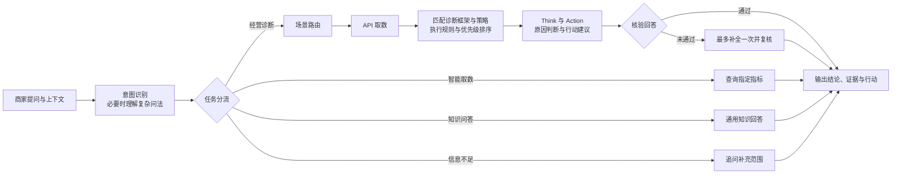
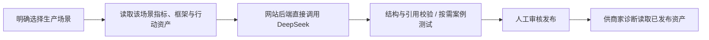

# AI经营看板与智能助手 & 诊断配置后台

AI经营看板与智能助手：面向内容电商商家的AI经营看板，内嵌智能助手。看板默认登录模拟商家账号与模拟经营数据，可以进入智能助手查询指标、了解经营知识、诊断经营问题。
诊断配置后台：面向运营人员的诊断资产、策略配置平台，用于向看板与智能助手提供经营分析方法。

[在线体验](https://ai-business-diagnosis-workflow.songge-huster.chatgpt.site/#merchant) ·[原扣子工作流](https://www.coze.cn/work_flow?workflow_id=7699762508375294003&space_id=7699761599875858474)

扣子编辑链接需要相应空间权限；公开查阅节点与提示词请直接阅读本仓库。

## 从这里开始

| 想了解什么 | 入口 |
|---|---|
| 当前 Main_agent 的实际节点、代码和连线 | [扣子工作流快照](coze/main-agent-current.workflow.json) |
| 业务路径、节点输入输出和变量 | [工作流说明](docs/workflow.md) |
| 四处 DeepSeek 调用的系统提示词 | [提示词原文](docs/prompts.md) |
| 前端看板、智能助手、AIDD 界面 | [site/web](site/web/) |
| 网站后端、流式转发、用量和权限 | [site/worker](site/worker/) |
| 本地预览与自行部署所需配置 | [运行说明](docs/setup.md) |
| 哪份文件对应哪个线上版本 | [来源与边界](docs/provenance.md) |

## 业务流程

商家业务采用一层主工作流；共用的 DeepSeek 适配层只处理模型请求、返回解析与 token 用量。



图中的场景路由、API 取数、框架与策略匹配是业务步骤，在当前扣子图中由同一个代码节点调用资源服务完成。流式面板展示可核验的执行进度和费用回执，不展示模型内部推理草稿。行动为提供给商家的建议，不自动执行投放等经营操作。

**AIDD 框架与策略生产是另一条独立链路：**



AIDD 生产不调用 Coze，也不使用商家提问的场景路由。

## 版本快照

- 整理日期：2026-11-11（北京时间）。
- 网站：已部署 v135 的源码。线上状态接口确认绑定 Main_agent：`7699762508375294003`。
- 扣子：当前保存画布导出，21 个节点、25 条连线；界面最新已发布版本为 v0.0.16，并显示存在未发布编辑。此导出明确标记为当前画布，不冒充新的发布版本。
- 当前画布的四处模型节点引用 DeepSeek_Model_Adapter v0.0.6。网站源码附带的后续构建稿引用 v0.0.7，二者分开保留，详见[版本说明](docs/provenance.md)。

## 本地查看

使用支持 `node:sqlite` 的 Node.js 22.13+。本项目没有额外 npm 依赖。

```sh
npm run build
npm test
npm run dev
```

打开 http://127.0.0.1:4173/#merchant。本地预览可查看界面和演示资产；在线问答需要另行配置自己的 Coze、DeepSeek 和资源服务。预览不会复用项目所有者的密钥或触发真实模型请求。

本仓库公开代码、演示资产和配置模板。密钥、在线数据库、访问令牌、账单、聊天记录及原仓库 Git 历史未打包。GitHub 用于源码查阅；在线体验仍由上方网站提供。
